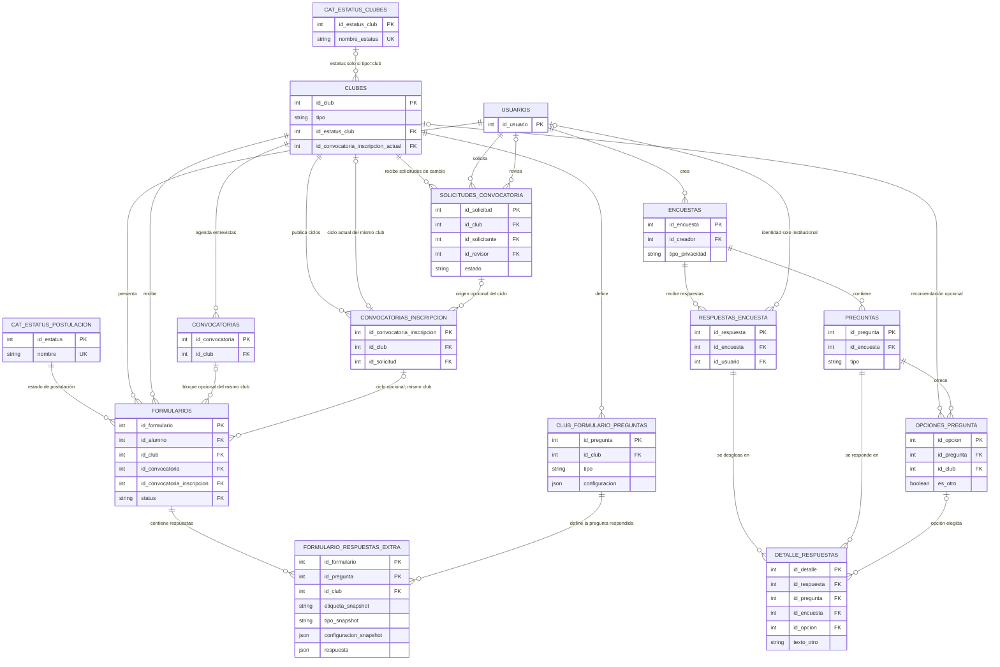

# Modelo de datos principal

Este diagrama resume los flujos de clubes y postulaciones, formularios configurables y encuestas. No pretende sustituir el esquema completo: la fuente definitiva de columnas, restricciones e índices es [`schema.sql`](../schema.sql).

## Reglas que no se ven solo con las líneas del diagrama

- `clubes` también contiene actividades. `tipo` distingue ambos recursos; restricciones reservan a los clubes el estatus operativo, el cupo y la participación. Las actividades usan `estado_publicacion` y no necesitan un estatus de club.
- Son tres conceptos distintos: `solicitudes_convocatoria` registra la petición del club que pasa por revisión; `convocatorias_inscripcion` representa el ciclo aprobado de recepción; `convocatorias` registra bloques de entrevista asociados a postulaciones. `formularios.id_convocatoria` y `formularios.id_convocatoria_inscripcion` guardan las dos relaciones directas de la postulación. Un índice único parcial impide que el mismo club tenga dos solicitudes pendientes.
- Cuando una postulación tiene ciclo o bloque de entrevista, ambos deben pertenecer al mismo club; el ciclo actual de un club también debe pertenecer a ese club. Las claves foráneas compuestas comprueban esas coincidencias, no solo que ambos identificadores existan.
- Cada respuesta configurable enlaza por claves compuestas al formulario y a la pregunta del mismo club. Sus snapshots conservan la etiqueta y configuración vigentes al contestar; editar la pregunta no reinterpreta respuestas históricas.
- En encuestas anónimas, `respuestas_encuesta.id_usuario` queda nulo; en las institucionales la API exige identidad. PostgreSQL impide mezclar la privacidad definida en la encuesta con la identidad de la respuesta y evita cambiarla después del envío.
- Cada detalle de encuesta debe vincular una respuesta y una pregunta de la misma encuesta. La opción elegida debe pertenecer a la pregunta registrada.
- `formularios.respuestas_extra` es el formato JSON histórico. Las respuestas configurables nuevas se guardan en `formulario_respuestas_extra`, una fila por pregunta, con su contexto histórico.

## Convenciones para cambios nuevos

- Tablas y columnas en `snake_case`; tablas con nombres de dominio en plural.
- Clave primaria `id_<entidad>` y claves foráneas con el mismo nombre de la clave referenciada.
- Nombres: `fk_` para claves foráneas, `chk_` para restricciones de fila, `uq_` para unicidad e `idx_` para índices no únicos.
- Declarar obligatorios los datos esenciales con `NOT NULL`; evitar defaults que mezclen reglas de tipos de recurso distintos.
- Usar una clave foránea para relaciones entre entidades y una restricción `CHECK` para valores permitidos dentro de una fila. Para catálogos administrables, referenciar la tabla de catálogo.
- Agregar migraciones nuevas al final de `managed.json`; no editar migraciones ya registradas. `schema.sql` describe una instalación vacía y no es el mecanismo para actualizar una base existente.
