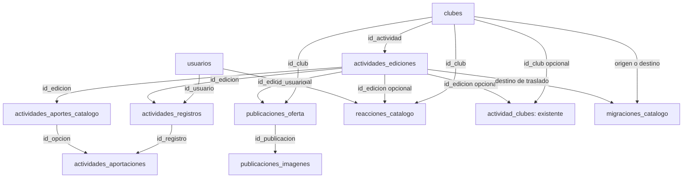

# Guía de estudio de la base de datos de clubes y actividades

El cambio principal es un catálogo compartido: `clubes` guarda tanto clubes como actividades. Cada registro tiene un `tipo`, mientras que sus procesos se guardan en tablas específicas. Así, una actividad puede tener ediciones e inscripciones sin convertirse en una membresía de club.

Esta guía explica la unificación introducida en `6c6aef9` respecto a `8f08b82` y su compactación posterior de once a ocho tablas nuevas. Describe los archivos actuales de la rama. La estructura final está en [schema.sql](../backend/schema.sql), desde el comentario `CATALOGO UNIFICADO`. Los ejemplos con IDs y participantes son ficticios.

Para estudiar por partes, empieza por el catálogo y el diagrama, continúa con los registros y la publicación, y termina con las [consultas de práctica](sql/estudiar-catalogo.sql) y las preguntas de repaso.

## Antes y después

| Aspecto | Estructura anterior al commit | Estructura actual |
| --- | --- | --- |
| Catálogo principal | `clubes` representaba clubes. | La misma tabla incorpora `tipo = 'club'` o `tipo = 'actividad'`. |
| Participación | `formularios` para postulaciones y `inscripciones` para membresías de clubes. | Esas tablas continúan; las actividades incorporan `actividades_registros`. |
| Fechas de una actividad | El esquema anterior no tenía el modelo general de ediciones. | `actividades_ediciones` reúne evento, registro y periodo de destacado. |
| Formulario de actividad | No existían campos configurables por edición en ese esquema. | `campos_registro` describe las preguntas; cada registro conserva las que respondió. |
| Aportaciones | No existía este proceso de compromisos por edición. | Se separan las opciones ofrecidas de las aportaciones elegidas por cada participante. |
| Fotografías | No existían las publicaciones compartidas de este módulo. | Una publicación tiene una descripción y varias imágenes. |
| Revisión del catálogo | El estado operativo del club no distinguía una propuesta de publicación. | Se separan la publicación vigente, la propuesta y su revisión. |

Durante el desarrollo también existió una versión con una tabla física `actividades` separada. La migración reconoce ese caso. En el modelo final, `actividades` es una **vista** y los datos principales se guardan en `clubes`.

## Control de tablas: de once a ocho

El conteo corresponde a las tablas que añade este módulo, no al total de tablas del proyecto. La versión compacta crea estas **ocho tablas físicas**:

| Tabla nueva | Qué almacena |
| --- | --- |
| `actividades_ediciones` | Cada realización de una actividad, con sus fechas y formulario. |
| `actividades_registros` | La inscripción del alumno a una edición. |
| `actividades_aportes_catalogo` | Opciones de aportación disponibles. |
| `actividades_aportaciones` | Compromisos elegidos y su recepción. |
| `publicaciones_oferta` | Descripción y destino de una publicación. |
| `publicaciones_imagenes` | Imágenes de cada publicación. |
| `reacciones_catalogo` | Reacciones tanto de clubes como de ediciones. |
| `migraciones_catalogo` | Correspondencias de IDs y traslados desde clubes anteriores. |

Se modifican dos tablas existentes: `clubes`, para el catálogo compartido, y `actividad_clubes`, para la bitácora compartida. Las tablas operativas de clubes conservan sus funciones y reciben las restricciones de tipo correspondientes.

| Antes: tablas físicas de la versión de once | Ahora: almacenamiento compartido | Reducción |
| --- | --- | --- |
| `clubes_reacciones` + `actividades_reacciones` | `reacciones_catalogo` | Una tabla menos. |
| `catalogo_equivalencias_actividades` + `actividades_legado_clubes` | `migraciones_catalogo` | Una tabla menos. |
| `actividades_historial` | Se reutiliza la existente `actividad_clubes`. | Una tabla nueva menos. |

Los cinco nombres sustituidos siguen disponibles como **vistas de solo consulta**. Una vista no agrega otra tabla física ni conserva otra copia de los datos. El respaldo opcional `actividades_catalogo_anterior` solo aparece si ya existía el catálogo separado; no se crea en una instalación nueva ni es una fuente operativa.

## Conceptos para leer el esquema

| Concepto | Significado en este proyecto |
| --- | --- |
| Tabla | Guarda filas de datos; por ejemplo, `actividades_registros`. |
| Clave primaria o PK | Identifica una fila. `id_registro` identifica una inscripción a una edición. |
| Clave foránea o FK | Conecta una fila con otra tabla. `actividades_registros.id_edicion` apunta a una edición existente. |
| Restricción | Rechaza datos que incumplen una regla, como un estado desconocido o un registro duplicado. |
| Vista | Presenta una consulta con un nombre reutilizable. Las vistas de este módulo no crean otra copia del catálogo. |
| JSONB | Guarda información con estructura JSON, como preguntas configurables y respuestas. |
| Índice | Ayuda a buscar filas por determinadas columnas. Un índice único también impide duplicados. |
| Trigger | Ejecuta una función cuando se intenta insertar, actualizar o eliminar una fila. |
| Transacción | Agrupa operaciones que deben completarse juntas; si fallan, sus cambios pueden revertirse. |

## La tabla clubes como catálogo compartido

Se conserva `id_club` para mantener las relaciones existentes. Aunque la tabla se llama `clubes`, una fila con `tipo = 'actividad'` representa una actividad.

Estos son los campos incorporados:

| Campo | Tipo | Para qué sirve |
| --- | --- | --- |
| `tipo` | `VARCHAR(12)` | Clasifica el registro como `club` o `actividad`. |
| `slug` | `VARCHAR(100)` | Identifica su dirección legible; es obligatorio y único en todo el catálogo. |
| `plantilla` | `VARCHAR(20)` | Selecciona las reglas `general`, `trineo` o `misiones`. Los clubes usan `general`. |
| `estado_publicacion` | `VARCHAR(20)` | Guarda si está en borrador, en revisión, publicada, rechazada o archivada. |
| `mostrar_en_oferta` | `BOOLEAN` | Configura su aparición en Oferta; la consulta pública también exige publicación aprobada. |
| `id_autor` | `INT` con FK a `usuarios` | Identifica a quien creó el registro. |
| `propuesta` | `JSONB` | Guarda cambios pendientes sobre una publicación vigente. |
| `estado_propuesta` | `VARCHAR(20)` | Controla la revisión de esos cambios. |
| `motivo_rechazo` | `TEXT` | Conserva las observaciones de la revisión. |
| `actualizado_en` | `TIMESTAMPTZ` | Registra la fecha y hora de actualización. |

También se amplía `nombre_club` de 100 a 160 caracteres, `categoria` de 50 a 80 y `imagen_portada` de `VARCHAR(255)` a `TEXT`.

`cupo_maximo` y `participacion` admiten `NULL` para actividades. Una restricción condicional sigue exigiendo ambos en los clubes, con los cupos permitidos. Los niveles se conservan en `clubes_niveles`; su selección también se valida en la aplicación.

`id_responsable_club` ya existía y ahora también identifica al encargado de una actividad. Su índice único se limita a filas de tipo club. Esto permite que una persona sea responsable de un club y, además, organice varias actividades.

### Tipo y estados

Conviene leer estos campos por separado:

| Campo | Pregunta que responde | Ejemplo |
| --- | --- | --- |
| `tipo` | ¿Qué clase de registro es? | `actividad` |
| `id_estatus_club` | ¿Cuál es la situación operativa del club? | Activo, próximamente o inactivo, según `cat_estatus_clubes`. |
| `estado_publicacion` | ¿En qué fase está su publicación? | `publicada` |
| `estado_propuesta` | ¿En qué fase están sus cambios pendientes? | `pendiente` |

El tipo se elige al crear el registro y un trigger impide cambiarlo después. Para un evento antiguo que se capturó como club existe un traslado revisado de sus registros.

## Relaciones entre las tablas



Las flechas van de la tabla referenciada a la que guarda la clave foránea. Cada edición pertenece a una actividad; una actividad puede tener varias ediciones. Cada registro pertenece a una edición y a un usuario. Las publicaciones de actividades también señalan su edición; las de clubes tienen `id_edicion = NULL`.

La relación que más puede confundir es esta:

```text
actividades_ediciones.id_actividad → clubes.id_club
```

Los nombres son distintos por compatibilidad con el módulo. El destino es la fila del catálogo compartido y un trigger exige que esa fila tenga `tipo = 'actividad'`.

### Tablas de actividades y participación

| Tabla | Una fila representa | Relaciones principales |
| --- | --- | --- |
| `actividades_ediciones` | Una realización concreta de una actividad. | Actividad del catálogo mediante `id_actividad`. |
| `actividades_registros` | La inscripción de un usuario a una edición. | `id_edicion` e `id_usuario`. |
| `actividades_aportes_catalogo` | Una opción de aportación, con unidad y mínimo. | `id_edicion`. |
| `actividades_aportaciones` | El compromiso de un participante con una opción. | `id_registro` e `id_opcion`. |

`formularios`, `inscripciones`, `convocatorias`, `horarios_club`, `sesiones` y `asistencias` siguen atendiendo los procesos de clubes. Una inscripción `confirmado` en actividades expresa que el registro quedó confirmado; no acredita la asistencia física al evento.

### Tablas de publicaciones

| Tabla | Información que guarda |
| --- | --- |
| `publicaciones_oferta` | Club o actividad de destino, edición cuando corresponde, descripción, autor y fecha. |
| `publicaciones_imagenes` | Publicación a la que pertenece cada imagen, URL, estado de revisión, orden e identificador del proveedor `public_id`. |

Por ejemplo, una publicación con cuatro fotos guarda su descripción una vez y tiene cuatro filas en `publicaciones_imagenes`. Cada imagen conserva su propio estado de revisión. Las filas guardan las direcciones de los archivos, no el contenido binario de las fotografías.

La clasificación antes/después se retiró. Los valores de reacción admitidos son `like`, `love` y `clap`. En actividades la reacción corresponde a una edición; en clubes corresponde al club.

### Reacciones compartidas

`reacciones_catalogo` tiene `id_reaccion` como PK, `id_club`, `id_edicion`, `id_usuario` y `reaccion`. Para reaccionar a un club, `id_edicion` es `NULL`. Para reaccionar a una actividad, se exige su edición y una FK compuesta comprueba que pertenezca a esa misma actividad.

Dos índices únicos parciales impiden duplicados: `(id_club, id_usuario)` cuando la edición es `NULL`, y `(id_edicion, id_usuario)` cuando tiene valor. Así, una cuenta puede reaccionar a varios clubes y a distintas ediciones, con una sola reacción por destino. Cambiar o retirar la reacción actualiza ese mismo conjunto de datos.

### Tablas de historial y transición

| Tabla | Función |
| --- | --- |
| `actividad_clubes` (existente) | Registra acciones de clubes y del catálogo, actor, detalle JSONB, fecha y edición cuando corresponde. |
| `migraciones_catalogo` | Reúne la equivalencia de IDs y el traslado de participantes, distinguidos mediante `tipo`. |

`migraciones_catalogo` conserva ambos procesos con sus propias reglas:

| `tipo` | Campos de referencia | Datos conservados |
| --- | --- | --- |
| `equivalencia_actividad` | `id_actividad_anterior` e `id_club_destino`. | `datos_originales` y `migrado_en`. |
| `traslado_club` | `id_club_origen`, `id_club_destino` e `id_edicion_destino`. | `resumen` y `migrado_en`. |

Los campos que no corresponden al tipo quedan en `NULL`. Las restricciones evitan repetir una equivalencia o trasladar el mismo club a dos ediciones. La edición de destino debe pertenecer a la actividad de destino; un trigger comprueba además que el origen sea un club y el destino una actividad.

### Qué hace la bitácora

`actividad_clubes` permite saber quién realizó una acción, cuándo ocurrió y a qué club, actividad o edición corresponde. Guarda, por ejemplo, la creación de una edición, su aprobación por Rectoría, una inscripción o la recepción de una aportación. Es una secuencia de acciones; no almacena una copia completa de cada versión para restaurarla.

Se conservan sus columnas anteriores y se añaden `id_edicion`, `origen` (`club` o `catalogo`) e `id_historial_actividad_anterior`. `tipo_evento` admite ahora 80 caracteres. Los eventos nuevos del módulo usan `origen = 'catalogo'`, incluso cuando la acción afecta la publicación de un club. `clubes.tipo` sigue indicando qué clase de recurso es.

La operación y su entrada se guardan en la misma transacción. Si falla la bitácora, también se revierte la operación. Al importar el historial anterior se conservan actor, acción, detalle y fecha. El `id_evento` es común y puede diferir del ID anterior; este último se conserva en `id_historial_actividad_anterior` y en la vista `actividades_historial.id_anterior`. Un evento cuyo destino antiguo no puede resolverse se conserva sin asignarle otro recurso. Si se elimina físicamente la cuenta del actor, el evento permanece con actor vacío.

Administración, Rectoría y Coordinación consultan **Gestión de Clubs → Bitácora de clubs y actividades**, con filtros por tipo de recurso, autor, acción y club o actividad. El historial administrativo general mantiene su apartado y tabla propios.

## Un ejemplo de registro completo

Supón que el catálogo contiene la actividad Trineo de los Sueños con `id_club = 20`. Para su realización de 2026 se crea la edición `501`, cuyo `id_actividad` es `20`. El siguiente año puede tener otra edición sin duplicar la descripción general de la actividad.

La edición reúne tres periodos distintos:

| Campos | Qué configuran |
| --- | --- |
| `fecha_inicio`, `fecha_fin`, `hora_inicio` | Cuándo ocurre el evento. |
| `inscripcion_desde`, `inscripcion_hasta`, `inscripciones_habilitadas` | Cuándo se permiten los registros y si están pausados. |
| `destacable`, `destacada_desde`, `destacada_hasta` | Durante qué periodo se muestra como destacada. |

La aplicación calcula la apertura y el destacado usando estos campos y la fecha del campus. La descripción puede permanecer en Oferta fuera del periodo de destacado.

### Preguntas y respuestas

`campos_registro` contiene la configuración del formulario. Este es un ejemplo abreviado:

```json
[
  {"clave":"edad","etiqueta":"Edad","tipo":"numero","obligatorio":true,"minimo":1,"maximo":120},
  {"clave":"talla","etiqueta":"Talla de camisa","tipo":"seleccion","obligatorio":true,"opciones":["CH","M","G"]},
  {"clave":"licenciatura","etiqueta":"Licenciatura","tipo":"licenciatura","obligatorio":false}
]
```

Al inscribirse, la persona queda identificada por `id_usuario`, `nombre_completo` y `matricula`. Sus respuestas adicionales se guardan en `respuestas`:

```json
{"edad":20,"talla":"M","licenciatura":1}
```

La licenciatura del ejemplo es un identificador del catálogo de licenciaturas. Al estar dentro de JSONB, su validación se hace en la aplicación.

El registro conserva además `formulario_snapshot`, una copia de las preguntas que respondió. Si luego cambia el formulario de la edición, puede interpretarse el registro con su configuración histórica.

Trineo y Misiones exigen edad y talla; licenciatura es opcional. Trineo también exige una aportación. Estas reglas se aplican en [actividadesDominio.js](../backend/lib/actividadesDominio.js), junto con la validación de opciones y respuestas.

### Opciones y compromisos de aportación

La edición ofrece una opción llamada Kit solidario, con unidad `piezas` y mínimo `2`. Esa opción se guarda en `actividades_aportes_catalogo`. Cuando una persona promete dos piezas, se crea su compromiso en `actividades_aportaciones`.

El compromiso copia nombre, unidad y mínimo, además de guardar la cantidad elegida. Si el mínimo del catálogo sube después a tres, el compromiso anterior conserva su mínimo de dos. Esta copia es intencional: permite mantener las condiciones aceptadas por el participante.

Un compromiso puede estar `comprometida`, `recibida` o `cancelada`. Al confirmar la recepción, `recibida_por` y `recibida_en` identifican quién la registró y cuándo.

## Publicación y propuestas

El catálogo usa `estado_publicacion`; las ediciones usan `estado`. Ambos admiten `borrador`, `pendiente`, `publicada`, `rechazada` y `archivada`. En la interfaz, `pendiente` aparece como en revisión y `rechazada` como con observaciones.

El flujo habitual es guardar un borrador, enviarlo a revisión y recibir una aprobación o una solicitud de cambios. Rectoría revisa la información general y cada edición por separado. La aplicación exige que la información general esté publicada antes de aprobar una edición.

Cuando se modifica una publicación vigente, las columnas publicadas conservan su contenido y los cambios se guardan en `propuesta`. Su `estado_propuesta` puede ser `borrador`, `pendiente` o `rechazada`; también puede ser `NULL` cuando no hay una propuesta activa.

Por ejemplo, el nombre publicado puede seguir siendo Trineo de los Sueños mientras `propuesta` contiene una nueva descripción. Al aprobar, la aplicación copia los valores aprobados a las columnas principales y limpia `propuesta` y `estado_propuesta`. Al pedir cambios, conserva la publicación vigente y registra el motivo.

La autorización de Rectoría se comprueba en el servidor. Los estados admitidos se restringen en SQL; esa restricción, por sí sola, no identifica el rol de quien envía una consulta directa.

## Vistas y reglas que protegen los datos

### Vistas del catálogo

| Vista | Qué presenta | Uso |
| --- | --- | --- |
| `catalogo_recursos` | Todas las filas de `clubes`, con nombres adaptados como `nombre`, `url_imagen` y `estado`. | Lectura y escritura del módulo compartido. `id_actividad` e `id_club` representan el mismo ID en esta vista. |
| `clubes_operativos` | Filas cuyo `tipo` es `club`. | Rutas anteriores de clubes; su `WITH LOCAL CHECK OPTION` también restringe escrituras a ese tipo. |
| `clubes_con_estado` | Clubes con conteos y estado calculado de su convocatoria. | Consultas existentes del portal y paneles. |
| `actividades` | Actividades del catálogo, con los nombres de columnas del diseño anterior. | Consulta compatible; un trigger bloquea las escrituras. |
| `actividades_fotos` | Unión de publicaciones e imágenes, incluyendo sus IDs de club y edición. | Consulta compatible de fotografías; el guardado escribe en las dos tablas físicas. |
| `clubes_reacciones`, `actividades_reacciones` | Reacciones de club y de edición, respectivamente. | Solo lectura sobre `reacciones_catalogo`. |
| `catalogo_equivalencias_actividades`, `actividades_legado_clubes` | Los dos tipos de correspondencia de migración. | Solo lectura sobre `migraciones_catalogo`. |
| `actividades_historial` | Eventos cuyo `origen` es `catalogo`. | Solo lectura sobre `actividad_clubes`, con referencia al ID anterior. |

`estado_calculado` en `clubes_con_estado` corresponde a la convocatoria del club. Se calcula con sus fechas, cierre y postulaciones; es distinto de `estado_publicacion`.

### Restricciones e índices importantes

| Regla | Cómo se representa |
| --- | --- |
| Direcciones sin duplicados en el catálogo. | Índice único `uq_catalogo_slug`. |
| Un responsable no ocupa dos clubes. | Índice único `uq_club_id_responsable_club`, limitado a `tipo = 'club'`. |
| Una cuenta no se registra dos veces en la misma edición. | `UNIQUE (id_edicion, id_usuario)`. |
| Una matrícula no aparece dos veces en la misma edición. | `UNIQUE (id_edicion, matricula)`. |
| No se repite la misma opción en un registro. | `UNIQUE (id_registro, id_opcion)`. |
| Una publicación no apunta a una edición de otra actividad. | FK compuesta de `publicaciones_oferta(id_edicion, id_club)` a `actividades_ediciones(id_edicion, id_actividad)`. |
| Una reacción es única por cuenta y destino. | Índices parciales `uq_reaccion_club_usuario` y `uq_reaccion_edicion_usuario`. |
| Una reacción, traslado o entrada con edición apunta a su actividad correcta. | FK compuesta de edición y recurso en cada tabla. |
| Se conservan relaciones con registros históricos. | Las FK principales de ediciones, registros, aportaciones y publicaciones usan `ON DELETE RESTRICT`. |

Los índices `idx_catalogo_tipo_publicacion`, `idx_actividades_ediciones_actividad` y `idx_actividades_registros_usuario`, entre otros, apoyan consultas frecuentes. Unificar el catálogo reduce la duplicación de su estructura; la velocidad de una consulta concreta depende también de sus filtros, índices y volumen de datos.

### Triggers y validaciones de la aplicación

| Protección | Dónde se aplica |
| --- | --- |
| Impedir membresías, formularios y otros procesos de club sobre una actividad. | Trigger `trg_catalogo_solo_club` en las tablas correspondientes. |
| Exigir que una edición pertenezca a una actividad. | Trigger `trg_catalogo_edicion_actividad`. |
| Conservar el tipo original del registro. | Trigger `trg_catalogo_tipo_estable`. |
| Exigir edición en publicaciones de actividades y omitirla en las de clubes. | Trigger `trg_publicacion_destino`, junto con las FK. |
| Aplicar la misma regla de destino a las reacciones. | Trigger `trg_reaccion_destino`, junto con las FK. |
| Comprobar los tipos del origen y destino de una correspondencia. | Trigger `trg_migracion_catalogo_destino`. |
| Generar un slug cuando falta al insertar. | Trigger `trg_catalogo_slug`. |
| Bloquear escrituras en el catálogo separado retirado y en la vista compatible. | Función `fn_catalogo_anterior_lectura` y sus triggers. |
| Exigir talla, edad, aportaciones y preguntas completas según la plantilla. | Validaciones del servidor. |
| Exigir que la cantidad comprometida cumpla el mínimo aplicable. | Validaciones del servidor; SQL exige cantidades y mínimos positivos. |
| Limitar una carga a diez fotos de hasta 5 MB cada una. | Validación de la carga en la aplicación. |

JSONB aporta flexibilidad para configurar formularios, pero su tipo de dato no comprueba por sí solo que una respuesta corresponda a una talla permitida. Por eso las validaciones del servidor forman parte del diseño.

## Cómo se conservan los datos anteriores

Hay dos recorridos que conviene distinguir:

1. **Unificación del catálogo separado.** Si existía una tabla física `actividades`, cada fila recibe un ID del catálogo compartido. `migraciones_catalogo` conserva la correspondencia con `tipo = 'equivalencia_actividad'`, se actualiza la relación de las ediciones y la tabla anterior queda como `actividades_catalogo_anterior`, protegida contra escrituras. Los IDs de los clubes existentes se conservan. Las fotos anteriores se incorporan a publicaciones e imágenes conservando sus IDs y estados; el campo `etapa` se retira.
2. **Traslado de un evento registrado como club.** Se eligen explícitamente el club de origen y la edición de destino. La aplicación ofrece una vista previa, conserva el origen y crea registros pendientes de completar cuando corresponde. Al aplicar, archiva el club anterior y cierra sus membresías activas. Esta operación se documenta en `migraciones_catalogo` con `tipo = 'traslado_club'` y no se ejecuta automáticamente al preparar el esquema.

En una instalación nueva no existe necesariamente `actividades_catalogo_anterior`: solo aparece cuando se convierte el catálogo físico anterior. `catalogo_equivalencias_actividades` puede estar vacía y la vista `actividades` ya puede mostrar las actividades institucionales.

Si la base ya tiene la versión de once tablas, la actualización copia sus reacciones, correspondencias e historial a las estructuras compartidas. Comprueba que los datos coincidan antes de sustituir las tablas por vistas; una incompatibilidad provoca la reversión de toda la actualización. Repetir la actualización no duplica esas filas. La prueba histórica de once tablas se conserva en `backend/tests/fixtures/catalogo-unificado-v1.sql` y no es un archivo de instalación.

`schema.sql` contiene la estructura final y la incorporación de versiones anteriores dentro de una transacción. `CREATE TABLE IF NOT EXISTS` crea tablas ausentes; los `ALTER TABLE` realizan los cambios sobre tablas existentes. El esquema completo incluye otros módulos del proyecto.

El programa manual [migrate.js](../backend/migrate.js) aplica ese archivo; el arranque del servidor no lo ejecuta. [seed.sql](../backend/seed.sql) contiene demostraciones para desarrollo, separadas de la estructura. Trineo y Misiones se incorporan con su descripción institucional, mientras que fechas, encargados, tallas, opciones y registros se configuran después.

Para los procedimientos de actualización y sus alternativas, consulta [ACTIVIDADES.md](ACTIVIDADES.md). Las migraciones históricas del módulo se conservan como alternativa y no se ejecutan adicionalmente después de aplicar el esquema completo.

## Consultas para practicar

Abre [estudiar-catalogo.sql](sql/estudiar-catalogo.sql) en el cliente que uses para PostgreSQL, conectado a una base de pruebas que ya tenga el esquema actualizado. Ejecuta el archivo completo para mantener su transacción de solo lectura.

Las diecisiete consultas permiten reconocer tablas y vistas, relacionar actividades con ediciones, examinar formularios JSONB, contar registros, comparar mínimos históricos, recorrer publicaciones, reacciones y bitácora y revisar restricciones e índices. Una base recién preparada puede no tener ediciones ni participantes, por lo que varias consultas devolverán cero filas.

El archivo empieza con `BEGIN TRANSACTION READ ONLY` y termina con `ROLLBACK`. No crea datos de ejemplo ni ejecuta las migraciones.

Al leer cada resultado, identifica la tabla de origen, su clave primaria y la columna usada en cada `JOIN`. Por ejemplo:

```sql
SELECT c.nombre_club AS actividad, e.nombre AS edicion
FROM clubes AS c
JOIN actividades_ediciones AS e ON e.id_actividad = c.id_club
WHERE c.tipo = 'actividad';
```

Esta consulta recupera el nombre general desde el catálogo y el nombre particular desde la edición. Una actividad sin ediciones no aparecerá con este `JOIN`; un `LEFT JOIN` permitiría incluirla.

## Preguntas de repaso

1. ¿Qué campo distingue a un club de una actividad? ¿Cuál controla su publicación?
2. ¿Por qué `id_actividad` de una edición apunta a `clubes.id_club`?
3. ¿Por qué se separa la actividad de sus ediciones?
4. ¿Qué diferencia hay entre `inscripciones` y `actividades_registros`?
5. ¿Qué conserva `formulario_snapshot` cuando cambia el formulario actual?
6. Si el mínimo de una opción sube de dos a tres, ¿qué mínimo conserva un compromiso anterior de dos?
7. ¿Cómo puede mantenerse pública una descripción mientras sus cambios están en revisión?
8. ¿Dónde se guarda la descripción de una publicación con cuatro fotografías?
9. ¿Una FK a `clubes` basta para impedir que una membresía apunte a una actividad?
10. ¿Un registro `confirmado` demuestra que la persona asistió al evento?
11. ¿Por qué una instalación nueva puede no tener `actividades_catalogo_anterior`?
12. ¿Qué revisa el servidor que JSONB por sí solo no comprueba?
13. ¿Por qué quedan ocho tablas nuevas aunque todavía veas cinco nombres anteriores?
14. ¿Cómo se distingue una reacción de club de una reacción de edición?
15. ¿Qué ocurre si falla la escritura de la bitácora durante una inscripción?

### Respuestas para comprobarte

1. `tipo` clasifica; `estado_publicacion` controla la publicación del catálogo.
2. La tabla principal es compartida. El trigger de ediciones exige que la fila de destino sea una actividad.
3. La descripción general se conserva y cada edición tiene fechas, formulario, registros y aprobación propios.
4. La primera guarda membresías de clubes; la segunda, inscripciones a ediciones de actividades.
5. Las preguntas y su configuración en el momento del registro.
6. El mínimo histórico de dos, copiado en `actividades_aportaciones`.
7. Conservando las columnas publicadas y guardando los cambios en `propuesta`, con su propio estado de revisión.
8. Una vez en `publicaciones_oferta.contenido`; las cuatro imágenes apuntan a esa publicación.
9. La FK comprueba que exista la fila. El trigger comprueba además que su tipo sea club.
10. Confirma la inscripción. La asistencia física es otro dato.
11. Esa tabla aparece al convertir un catálogo separado que ya existía.
12. Requisitos de la plantilla, opciones permitidas, tipos de respuesta y reglas de aportaciones, entre otros.
13. Esos cinco nombres son vistas sobre las estructuras compartidas. Se fusionaron reacciones y correspondencias y se reutilizó una bitácora existente.
14. Ambas están en `reacciones_catalogo`: la de club tiene edición vacía; la de actividad apunta a su edición.
15. La transacción se revierte y la inscripción no queda confirmada sin su entrada de historial.

## Archivos para profundizar

| Archivo | Qué estudiar |
| --- | --- |
| [schema.sql](../backend/schema.sql) | Tablas, vistas, índices, FK, restricciones, triggers y conversión del catálogo. |
| [actividadesDominio.js](../backend/lib/actividadesDominio.js) | Validación de campos, fechas, formularios, mínimos y reglas de Trineo y Misiones. |
| [actividadesRouter.js](../backend/lib/actividadesRouter.js) | Permisos, transacciones, publicación, propuestas y registros. |
| [mediosOferta.js](../backend/lib/mediosOferta.js) | Guardado de una publicación y sus imágenes. |
| [actividadesLegado.js](../backend/lib/actividadesLegado.js) | Vista previa y aplicación del traslado desde un club anterior. |
| [actividadCatalogo.js](../backend/lib/actividadCatalogo.js) | Registro transaccional de acciones y resolución de su actividad y edición. |
| [actividadConsultaRouter.js](../backend/lib/actividadConsultaRouter.js) | Consulta autorizada, filtros y paginación de la bitácora compartida. |
| [catalogoMigracion.integration.test.mjs](../backend/tests/catalogoMigracion.integration.test.mjs) | Comprobaciones de IDs, historial, fotos y repetición del esquema. |
| [catalogoCompacto.integration.test.mjs](../backend/tests/catalogoCompacto.integration.test.mjs) | Ocho tablas finales y conservación de datos al actualizar la versión de once. |

Para estudiar la unificación original y la compactación actual desde la terminal del proyecto:

```sh
git diff 8f08b82 6c6aef9 -- backend/schema.sql
git diff 6c6aef9 -- backend/schema.sql backend/migrations/migrate-catalogo-unificado.sql
```
